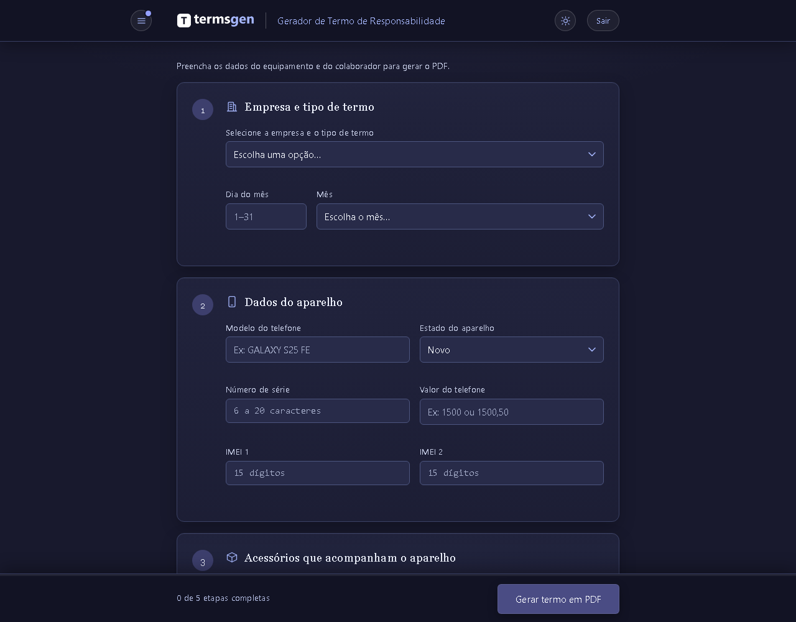
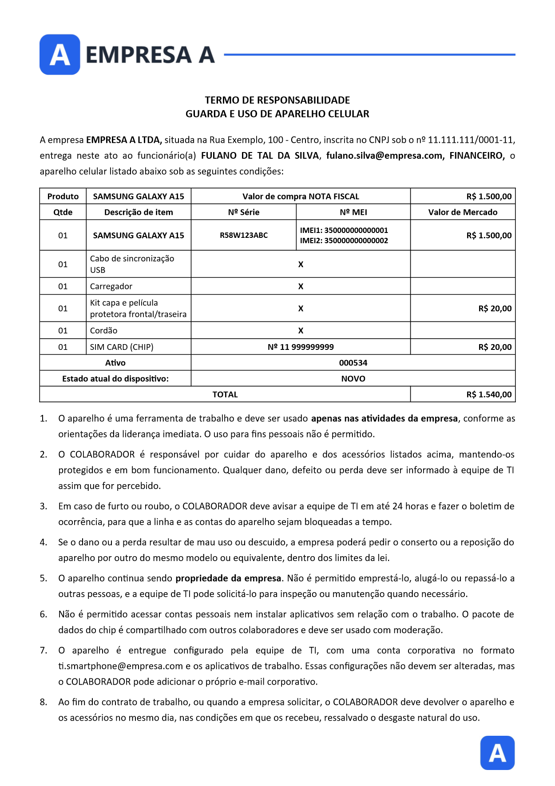

# termsgen — Gerador de Termos de Responsabilidade

Sistema web para a equipe de TI gerar, em PDF, os termos de entrega, devolução e
férias de aparelhos corporativos, enviar cada termo para assinatura eletrônica no
[Clicksign](https://www.clicksign.com/) e acompanhar quem já assinou.

O formulário valida os dados no navegador e no servidor, preenche um modelo Word
(`.docx`) e converte o resultado em PDF com o LibreOffice.

> **Versão de demonstração.** As empresas (A, B, C e D), os modelos de termo, os
> CNPJs e os endereços são fictícios.

| Formulário | Termo gerado |
|---|---|
|  |  |

## Funcionalidades

- **Termos de aparelho celular:** responsabilidade, devolução e férias, com
  acessórios, estado de conservação, chip, etiqueta de patrimônio e fotos da frente
  e do verso no anexo.
- **Assinatura dupla:** o mesmo termo para dois colaboradores responsáveis pelo
  mesmo aparelho. Cada um assina com o próprio link.
- **Cautela de equipamento:** entrega e devolução de notebooks, carregadores e
  outros itens (até 6 por cautela), com até 3 fotos.
- **Regras por empresa:** a EMPRESA D mostra como uma empresa pode ter regras
  próprias. O termo dela não tem setor nem e-mail, e a etiqueta tem 3 dígitos em
  vez de 6.
- **Assinatura eletrônica (opcional):** envio ao Clicksign pela API v3, com código
  por e-mail, selfie dinâmica e observadores que recebem o PDF assinado. Se o envio
  falhar, o PDF é baixado do mesmo jeito.
- **Painel de termos enviados:** busca, filtro por situação (aguardando, prazo
  vencido, assinado, cancelado) e atualização sob demanda, sem webhook.
- **Login** com credencial única, tema claro e escuro, e menu com o histórico de
  novidades.

## Tecnologias

- **Servidor:** Node.js, Express, Multer e o SQLite embutido no Node (`node:sqlite`).
- **Documentos:** docxtemplater (com o módulo de imagem) e PizZip para preencher o
  `.docx`, e LibreOffice em modo headless para gerar o PDF.
- **Interface:** HTML, CSS e JavaScript puros (ES modules), sem framework e sem
  etapa de build. As regras de validação ficam num arquivo só
  ([public/js/validations.js](public/js/validations.js)), importado pelo navegador
  e pelo servidor.

## Como rodar

**Requisitos:** Node.js 22.13 ou mais novo e o LibreOffice instalado.

O sistema procura o `soffice` no `PATH`. No Linux: `sudo apt install libreoffice-writer`.
No Windows, também funciona com o [LibreOffice Portable](https://www.libreoffice.org/download/portable-versions/)
extraído numa pasta `LibreOfficePortable/` na raiz do projeto.

```bash
git clone <url-deste-repositório> termsgen
cd termsgen
npm install
cp .env.example .env
npm run login:senha    # digite a senha; copie a linha LOGIN_SENHA_HASH=... para o .env
npm start              # ou npm run dev, que reinicia a cada alteração
```

Defina também `LOGIN_USUARIO` no `.env` e abra `http://localhost:3000`. Sem login
configurado, ninguém entra, e o servidor avisa ao iniciar.

O Clicksign é opcional. Sem `CLICKSIGN_ACCESS_TOKEN`, o sistema só gera o PDF.
Para testar a assinatura, use uma conta de sandbox do Clicksign.

## Configuração

As variáveis principais estão comentadas no [.env.example](.env.example).

| Variável | Uso |
|---|---|
| `PORT` | Porta do servidor (padrão 3000) |
| `FUSO_HORARIO` | Fuso do ano impresso nos termos (padrão `America/Sao_Paulo`) |
| `LOGIN_USUARIO` / `LOGIN_SENHA_HASH` | Credencial de acesso. O hash vem de `npm run login:senha` |
| `LOGIN_SESSAO_HORAS` | Horas até a sessão expirar (padrão 8) |
| `CLICKSIGN_ACCESS_TOKEN` | Token da API do Clicksign. Sem ele, o envio para assinatura não aparece |
| `CLICKSIGN_AMBIENTE` | `sandbox` (padrão) ou `producao` |
| `CLICKSIGN_PASTA_ID` / `CLICKSIGN_OBSERVADORES` | Pasta dos envelopes e e-mails dos observadores. Obrigatórios em produção |
| `CLICKSIGN_PRAZO_DIAS`, `CLICKSIGN_OBSERVADOR_QUANDO`, `CLICKSIGN_OBSERVADOR_RECEBE_DOCUMENTO` | Ajustes opcionais do envelope |
| `PAINEL_INTERVALO_MINUTOS` | Intervalo mínimo entre conferências no Clicksign (padrão 10) |
| `BANCO_ARQUIVO` | Caminho do banco do painel (padrão `dados/termsgen.db`) |

Comandos auxiliares:

```bash
npm run login:senha                                 # gera o hash da senha
npm run clicksign:pastas                            # lista as pastas da conta e seus IDs
npm run clicksign:importar -- --desde=2026-01-01    # traz para o painel os termos já existentes na pasta
```

## Estrutura

```
src/
  server.js          rotas, validação no servidor e envio do PDF
  gerarTermo.js      preenche o .docx e converte em PDF
  clicksign.js       integração com a API v3 do Clicksign
  auth.js            login, sessões e limite de tentativas
  banco.js           banco SQLite do painel
  painel.js          registro, atualização e importação dos termos enviados
public/
  index.html         formulário do termo (também servido em /assinatura-dupla)
  cautela.html       formulário da cautela
  painel.html        termos enviados
  login.html
  css/style.css      tema claro e escuro, todo em variáveis CSS
  js/validations.js  regras de validação, compartilhadas com o servidor
  js/menu.js         menu lateral (opções, novidades e notas técnicas)
  js/novidades.js    histórico de versões exibido no menu
templates/
  termos/            um modelo por empresa e tipo (EMPRESA_A.docx, EMPRESA_A_dev.docx, EMPRESA_A_fer.docx...)
  duplaAssinatura/   os mesmos modelos, com dois colaboradores
  cautela/           cautela de entrega e de devolução
scripts/             comandos do npm run
dados/               banco do painel (criado sozinho, fora do Git)
```

## Modelos de documento

Os modelos são arquivos Word comuns com tags do
[docxtemplater](https://docxtemplater.com/). Dá para editá-los no Word ou no
LibreOffice sem mexer no código, desde que as tags fiquem iguais.

| Tag | Conteúdo |
|---|---|
| `{name}`, `{email}`, `{setor}` | Colaborador. Na assinatura dupla, também `{name2}` e `{email2}` |
| `{dia}`, `{mes}`, `{ano}` | Data do termo |
| `{modelCel}`, `{serialNumber}`, `{imei1}`, `{imei2}`, `{valor}` | Aparelho |
| `{eC}`, `{eCExtenso}` | Estado do aparelho: a letra (N, B, R) e o texto por extenso |
| `{qtUsb}`, `{CaboSincUsb}`, `{eU}`... | Quantidade, marcação e estado de cada acessório |
| `{#temCordao}...{/temCordao}` | Linha que só aparece quando o cordão foi marcado |
| `{numeroTel}`, `{etiqueta}`, `{valorFinal}` | Chip, etiqueta de patrimônio e valor total |
| `{%fotoFrente}`, `{%fotoVerso}` | Fotos do aparelho |

A cautela usa `{name}`, `{usuario}`, `{setor}`, `{data}`, os laços
`{#hardwares}` e `{#vazios}`, as fotos `{%foto1}` a `{%foto3}` e `{#descricao}`.

**Para adicionar uma empresa:**
1. Crie os modelos `EMPRESA_X.docx`, `EMPRESA_X_dev.docx` e `EMPRESA_X_fer.docx` em
   `templates/termos/` e em `templates/duplaAssinatura/`.
2. Inclua os três nomes em `EMPRESAS_VALIDAS`, em [src/server.js](src/server.js).
3. Adicione as opções no `<select id="empresa">` de [public/index.html](public/index.html).

Para dar regras próprias a uma empresa, veja `temRegraPropria` em
[public/js/validations.js](public/js/validations.js).

## Segurança e privacidade

- **Login:** a senha é guardada só como hash `scrypt`, com sal aleatório. A sessão
  fica num cookie `HttpOnly` e `SameSite=Strict`.
- **Limite de tentativas:** o login aceita até 10 chamadas por minuto de cada IP e
  30 no total. Depois de 5 senhas erradas seguidas, novas tentativas ficam
  bloqueadas por 5 minutos.
- **Nada fica guardado no servidor:** fotos e PDFs existem só durante a geração e o
  download, e são apagados em seguida, inclusive quando o formulário é recusado.
- **Logs:** as falhas de envio ao Clicksign registram só a mensagem técnica, sem
  nome nem e-mail do colaborador.
- **Banco do painel:** guarda nome, e-mail de assinatura, tipo de termo e datas. A
  pasta `dados/` fica fora do Git e deve entrar no backup.
- **Token do Clicksign:** fica só no servidor e nunca vai para o navegador.

## Limitações conhecidas

- O acesso é por uma credencial única, sem login individual por pessoa.
- As sessões ficam na memória. Reiniciar o serviço desconecta todo mundo.
- Atrás de um proxy, todos os acessos chegam com o mesmo IP. Por isso, o limite de
  tentativas vale para todos ao mesmo tempo.
- O status das assinaturas é conferido quando alguém abre o painel, porque o
  webhook do Clicksign exigiria o servidor acessível pela internet.
- A opção "Multi fotos" do menu ainda está em desenvolvimento.

## Versão

O rodapé mostra `MAIOR.MENOR` do `package.json` seguido da quantidade de commits
(ex: v1.5.12). Ao lançar uma versão, suba o `version` no `package.json` e adicione
um bloco no topo de [public/js/novidades.js](public/js/novidades.js). Ele aparece
no menu, com um selo "Novo" para quem ainda não viu.
